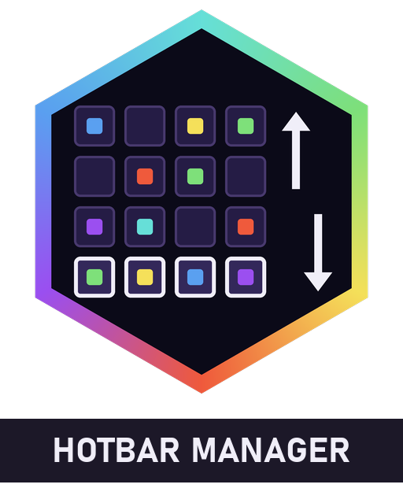

<div align="center">



# Alaydriem's Hotbar Manager

[](https://github.com/alaydriem/amml-hotbar-manager/releases)
[](https://github.com/alaydriem/amml-hotbar-manager/actions/workflows/build.yml)
[](./LICENSE)

[](https://github.com/alaydriem/amml)

</div>

An [AMML](https://github.com/alaydriem/amml) client mod for Minecraft Bedrock (Windows) that rotates your inventory rows through the hotbar, sorts containers and moves items in bulk. It works on any world or server. The server needs no mod.

## Features

- **Row rotation.** Two keybinds move the four inventory rows (the hotbar and the three rows above it) up or down. Each of the 9 columns turns as a separate cycle. Four presses in one direction restore the first layout. Armor and offhand do not move. The selected hotbar slot does not change. Rotation works only when no screen is open.
- **Sort button on containers.** A button next to the close button of a container sorts that container. It sorts the container only, not your inventory. First it merges part-stacks. Then it orders the stacks by item id, A to Z. For the same item, larger stacks come first. Empty slots go to the end. The sort keybind does the same for the open container. Put down the stack on the cursor first: while you hold a stack, Sort does nothing.
- **4 dump buttons on containers.**
  - From inventory: moves all items from the inventory rows and the hotbar to the container.
  - From container: moves all items from the container to the inventory. Items go to the hotbar first, then the inventory, as a vanilla shift-click does.
  - From inventory, filtered: moves every stack that matches the stack you hold on the cursor to the container.
  - From container, filtered: moves every stack that matches the stack you hold on the cursor to the inventory.
- **2 drop buttons on the inventory screen.**
  - Drop all: drops all items from the inventory rows (not the hotbar).
  - Drop filtered: drops every stack that matches the stack you hold on the cursor, and that stack.

"Match" means the same item id and data value as the stack you hold on the cursor. If you hold nothing, the filtered buttons do nothing. The dump buttons leave the held stack on the cursor.

Sort works on chests, trapped chests, barrels, shulker boxes, ender chests, hoppers, dispensers, droppers, and the chest and hopper minecarts. Some containers show fewer dump buttons. Hoppers, dispensers and droppers show only the two filtered dump buttons.

## Installation

Install it with the [AMML launcher](https://github.com/alaydriem/amml/releases/latest). The launcher also installs the AMML loader and Alaydriem's Mod Manager, which this mod needs.

## Usage

Change the keys on the mod manager's Keybinds page.

| Keybind | Default | Action |
| --- | --- | --- |
| Rotate rows up | <kbd>Alt</kbd> + <kbd>D</kbd> | The hotbar gets the first row above it |
| Rotate rows down | <kbd>Alt</kbd> + <kbd>A</kbd> | The hotbar gets the third row above it |
| Sort open container | <kbd>Alt</kbd> + <kbd>X</kbd> | Sorts the container that is open |

## Classic UI only

The buttons show only in the Classic UI profile. In the Pocket UI profile the mod draws no buttons. Row rotation and the sort keybind still work in the Pocket UI profile.

## Realms and servers

Sort, the dump buttons and the drop buttons use the game's own container screen handlers, as a vanilla click or shift-click does. A server or Realm can have anti-cheat that rejects fast moves. If the server rejects a move, the game puts that move right itself, and the items stay where the server says they are. A dump or drop sends all its moves at once. Sort reads the container again before each step, and stops after 3 steps that change nothing or at its step limit. The row rotation sends vanilla item stack requests and stops at the first rejected request. It also waits while an earlier move still waits for the server's answer: press the key again a moment later.

## Building

Requires Windows x64, [mise](https://mise.jdx.dev), rustup and [cargo-nextest](https://nexte.st).

```powershell
mise trust
mise run preflight
mise run check
mise run test
mise run package
```

`mise run package` writes `dist/@alaydriem/hotbar-manager/`. `mise run install --instance <name>` runs `package`, then copies it into `%LOCALAPPDATA%\amml\instances\<name>\mods\amml\@alaydriem\hotbar-manager\`. Close the game first.

## License

BSD 3-Clause. Copyright (c) 2026 Charles R. Portwood II. See [LICENSE](./LICENSE).
